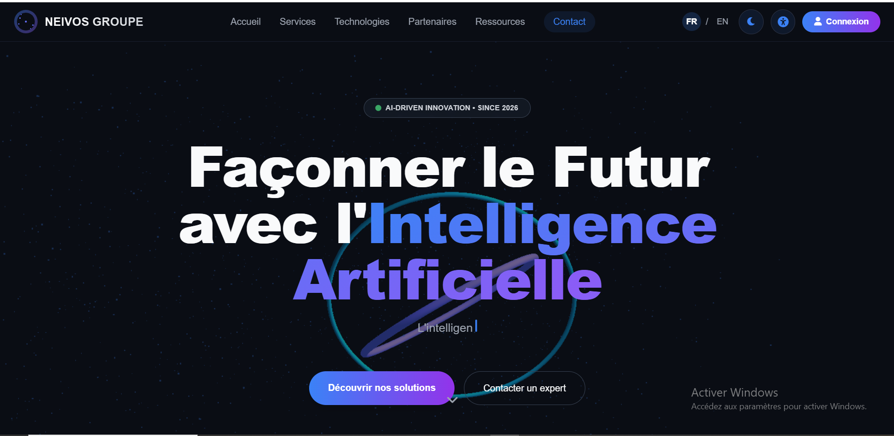
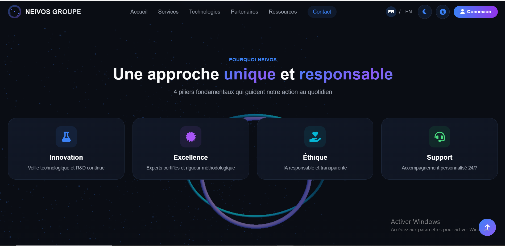
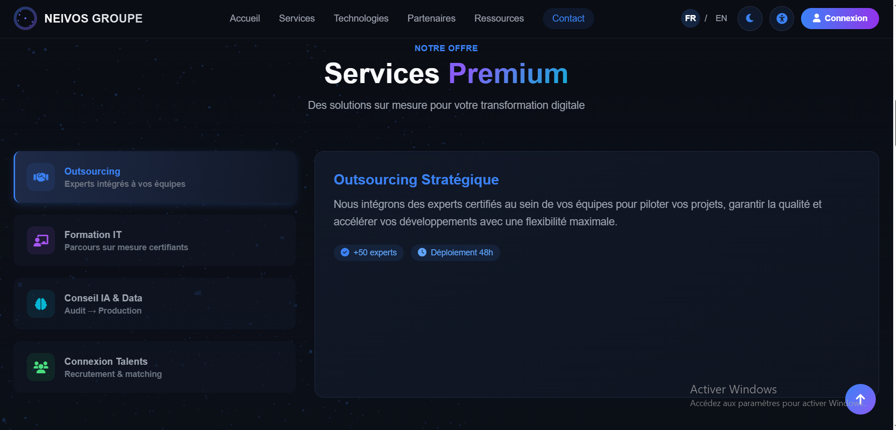
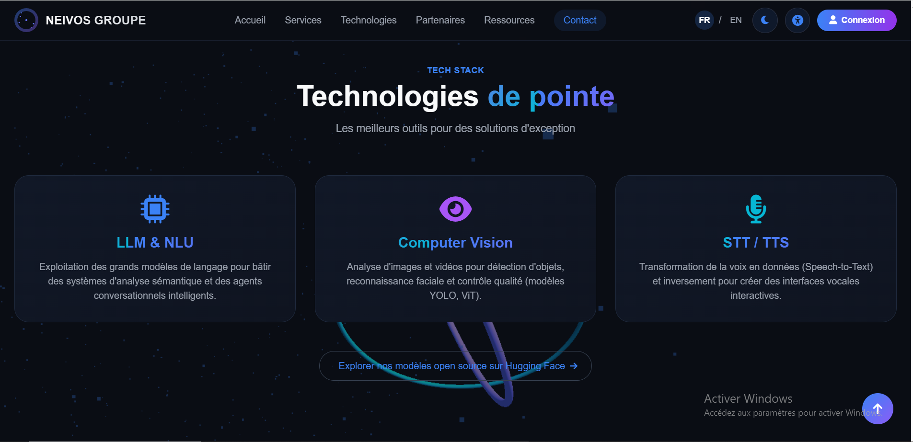
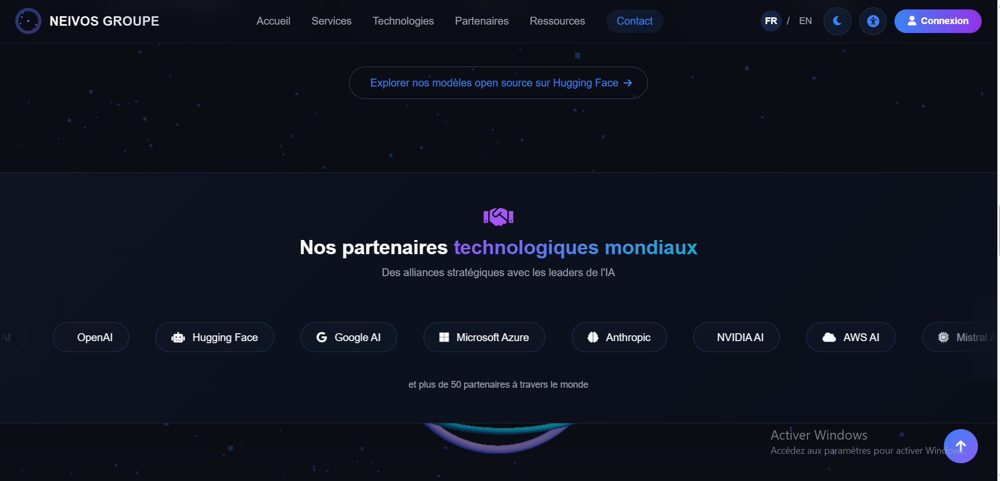
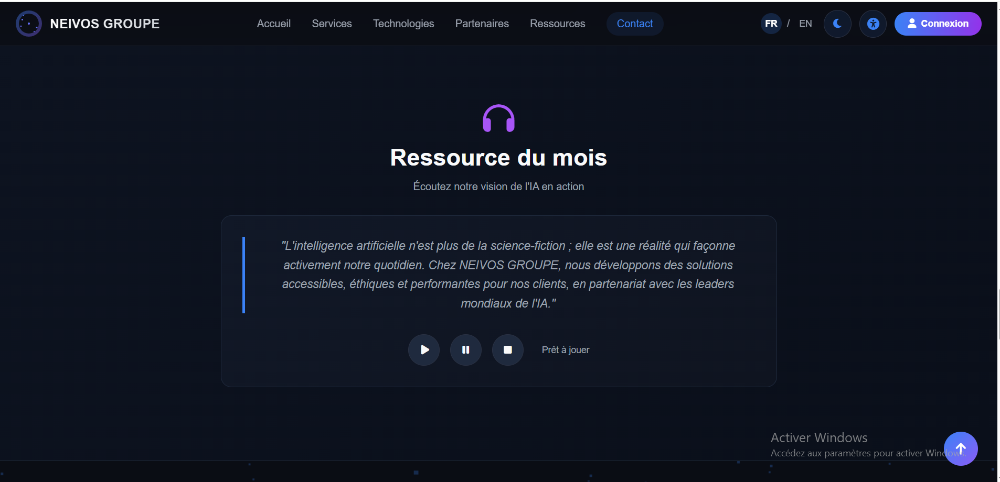
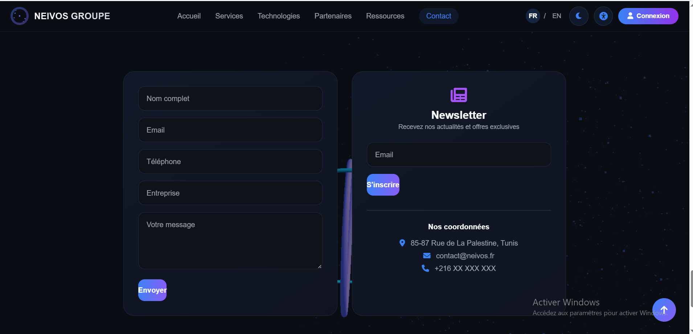

# Neivos Groupe — Plateforme web et services numériques

Plateforme web combinant une vitrine publique, des parcours clients et une interface d’administration connectée à un backend Node.js/Express et à une base de données MySQL.

<p align="center">

[](https://neivos-groupe.vercel.app/)
[](https://nodejs.org/)
[](https://expressjs.com/)
[](https://www.mysql.com/)

</p>

## Présentation

Le projet propose une expérience web responsive pour présenter des services numériques et centraliser différentes interactions avec les clients. Le frontend communique avec un backend Node.js/Express qui gère les routes applicatives et la persistance des données.

## Fonctionnalités

### Interface publique
- Présentation de l’entreprise, de ses services et de ses technologies.
- Interface adaptée aux écrans mobiles et de bureau.
- Navigation et interactions visuelles.
- Accès aux parcours de connexion et d’inscription.

### Espace client et administration
- Parcours d’authentification et tableau de bord.
- Routes d’administration protégées.
- Gestion des services et des technologies.
- Consultation des utilisateurs et des demandes enregistrées.
- Outils de suivi et d’administration selon la configuration du projet.

### Backend et intégrations
- API REST avec Node.js et Express.js.
- Persistance MySQL via le client mysql2.
- Authentification par JWT et hachage des mots de passe avec bcryptjs.
- Validation des entrées et limitation du débit sur les routes configurées.
- Notifications Discord via webhook ou bot selon la configuration.
- Variables d’environnement pour les paramètres sensibles.

## Technologies

| Domaine | Technologies |
|---|---|
| Interface | HTML, CSS, JavaScript |
| Styles et icônes | Tailwind CSS, Font Awesome, Google Fonts |
| Visualisation | Three.js, Leaflet |
| Backend | Node.js, Express.js |
| Base de données | MySQL, mysql2 |
| Authentification | JWT, bcryptjs |
| Validation et protection | express-validator, express-rate-limit, CORS |
| Intégrations | Discord.js, webhooks Discord |
| Outils | npm, Nodemon, Git |
| Déploiement de la démo | Vercel |

## Structure du dépôt

```text
Neivos-Groupe/
├── database/
│   └── init.sql
├── public/
│   ├── index.html
│   ├── dashboard.html
│   ├── admin.html
│   ├── admin-dashboard.html
│   ├── script.js
│   ├── admin-script.js
│   └── style.css
├── .env.example
├── create-admin.js
├── discord-bot.js
└── README.md
```

L’arborescence peut évoluer ; référez-vous aux fichiers présents dans le dépôt pour les détails exacts.

## Captures d’écran

Les captures ci-dessous illustrent l’interface de **Neivos Groupe**. Les fichiers sont disponibles dans [docs/img/](docs/img/).

<p align="center">
  
</p>

<p align="center">
  
</p>

<p align="center">
  
</p>

<p align="center">
  
</p>

<p align="center">
  
</p>

<p align="center">
  
</p>

<p align="center">
  
</p>

> **Note :** les noms des fichiers sont sensibles aux majuscules et minuscules. Conserve exactement l’extension `.PNG` utilisée dans le dépôt.

## Démonstration

- **Application :** [neivos-groupe.vercel.app](https://neivos-groupe.vercel.app/)
- **Code source :** [GitHub — Neivos-Groupe](https://github.com/WissemAttouf/Neivos-Groupe)

## Installation locale

### Prérequis
- Node.js et npm
- MySQL ou MariaDB
- Git

### Étapes

```bash
git clone https://github.com/WissemAttouf/Neivos-Groupe.git
cd Neivos-Groupe
npm install
```

Copiez `.env.example` vers `.env` s’il est présent, puis configurez les paramètres de base de données et les secrets requis. Importez le schéma SQL fourni dans `database/` si le projet l’utilise. Consultez les scripts de `package.json` pour identifier la commande de démarrage adaptée à votre version du dépôt.

**Sécurité :** ne commitez jamais le fichier `.env`, les mots de passe, les jetons JWT ou les identifiants de services.

## Auteur

**Wissem Attouf** — Ingénieur logiciel | Développeur Full Stack  
[GitHub](https://github.com/WissemAttouf) · [LinkedIn](https://www.linkedin.com/in/wissem-attouf-452509226/) · [Portfolio](https://wissem-portfolio.vercel.app/) · [E-mail](mailto:wattouf35@gmail.com)


---

## 📸 Captures d’écran

<p align="center">
  
  <br><strong>Aperçu principal</strong>
  <br><em>Vue d’ensemble de l’interface de Neivos Groupe.</em>
</p>

<p align="center">
  
  <br><strong>Vue complémentaire</strong>
  <br><em>Autre aperçu de la plateforme et de son organisation visuelle.</em>
</p>

<p align="center">
  
  <br><strong>Interface — aperçu 3</strong>
  <br><em>Vue complémentaire de l’expérience web.</em>
</p>

<p align="center">
  
  <br><strong>Interface — aperçu 4</strong>
  <br><em>Écran supplémentaire de la plateforme.</em>
</p>

<p align="center">
  
  <br><strong>Interface — aperçu 5</strong>
  <br><em>Vue supplémentaire pour illustrer l’interface.</em>
</p>

<p align="center">
  
  <br><strong>Interface — aperçu 6</strong>
  <br><em>Autre aperçu de l’application web.</em>
</p>

<p align="center">
  
  <br><strong>Interface — aperçu 7</strong>
  <br><em>Dernière vue de la galerie de présentation.</em>
</p>
